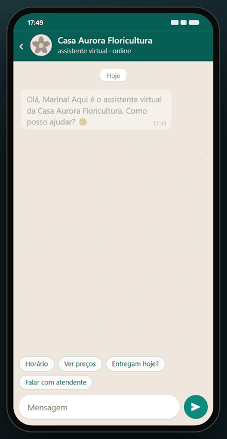
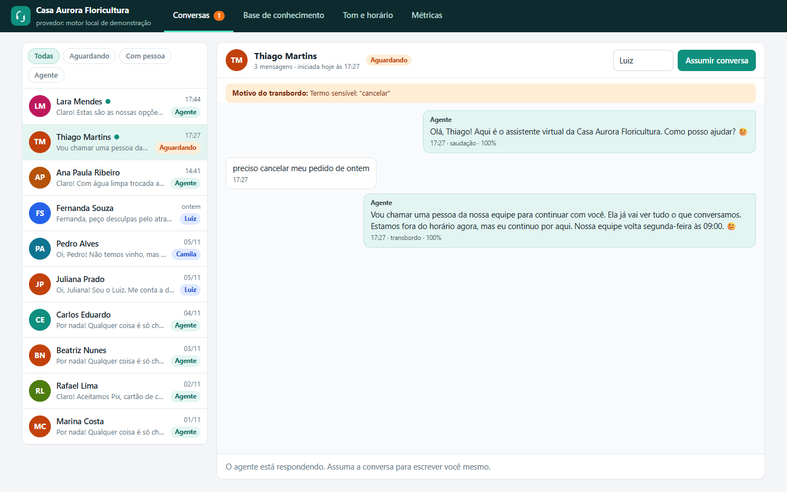
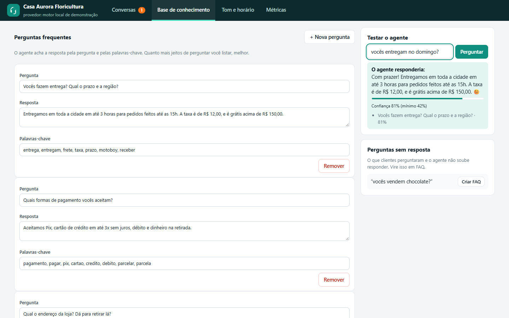
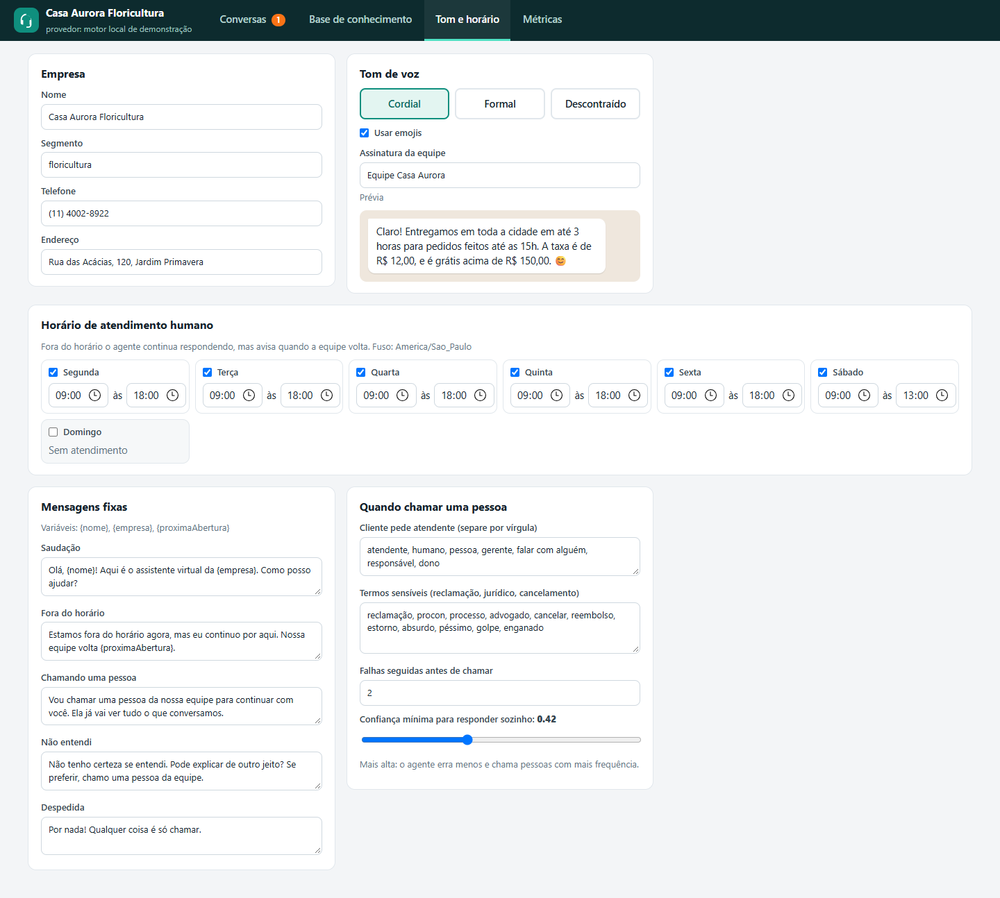
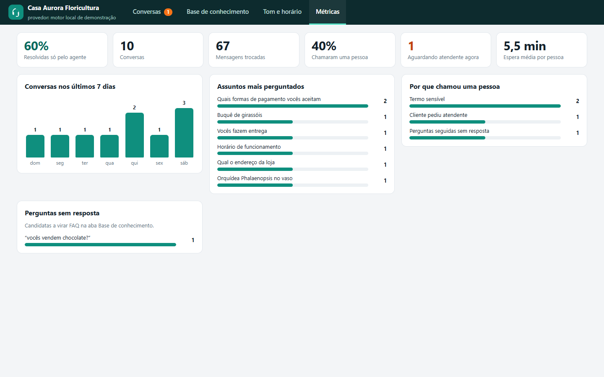
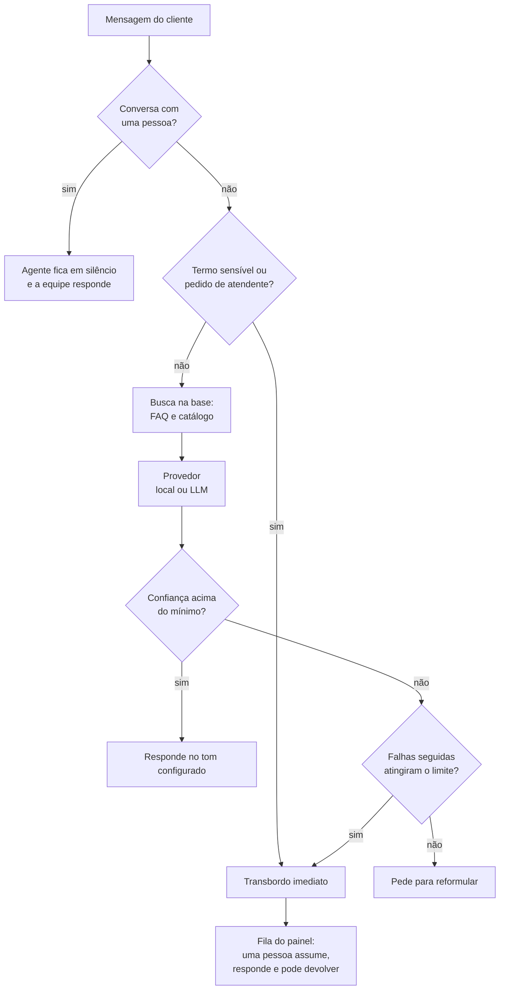

# Agente de Atendimento

Agente de atendimento por IA para qualquer empresa. Quem cuida do negócio configura nome, tom de voz, horário, perguntas frequentes, catálogo e regras de transbordo em um painel (ou em um arquivo JSON), e o agente atende clientes em uma conversa estilo WhatsApp, chamando uma pessoa quando precisa. TypeScript, Node 24, zero dependências, e roda sem chave de API.

[](https://github.com/luizrenatodc/agente-atendimento/actions/workflows/testes.yml)
[](LICENSE)



## Veja funcionando

A conversa acima é gravada de verdade: um navegador abre a tela do cliente, digita as mensagens, o servidor responde pelo motor local e, no final, uma pessoa da equipe assume pelo painel. Nada é montado à mão.

| Painel: conversas e transbordo | Painel: base de conhecimento |
|---|---|
|  |  |

| Painel: tom de voz, horário e regras | Painel: métricas |
|---|---|
|  |  |

## Como rodar

```bash
npm start
```

Precisa só do Node 24 ou mais novo. Sem `npm install`, sem chave.

- Cliente: <http://localhost:3000/>
- Painel da equipe: <http://localhost:3000/admin>

Na primeira execução o servidor cria dez conversas de exemplo, passando pelo motor de verdade, para o painel não nascer vazio. `SEMEAR=0` desliga isso.

```bash
npm test      # 46 testes: motor, horário, regras de transbordo, API HTTP, provedor de LLM
```

### Variáveis de ambiente

| Variável | Para quê | Padrão |
|---|---|---|
| `PORT` | porta HTTP | `3000` |
| `ARQUIVO_CONFIG` | onde o painel grava a configuração | `dados/config.json` |
| `ARQUIVO_ESTADO` | onde ficam as conversas | `dados/estado.json` |
| `ADMIN_TOKEN` | exige o cabeçalho `x-token` em `/api/admin` | desligado |
| `SEMEAR` | `0` não cria conversas de exemplo | ligado |
| `PROVEDOR` | `llm` troca o motor local por um modelo de linguagem | `local` |
| `LLM_API_KEY`, `LLM_BASE_URL`, `LLM_MODELO` | acesso ao modelo (API no formato chat completions) | OpenAI, `gpt-4o-mini` |

## O que a empresa configura

| Onde | O quê |
|---|---|
| Empresa | nome, segmento, telefone, endereço |
| Tom de voz | cordial, formal ou descontraído, com ou sem emoji |
| Horário | faixa por dia da semana, no fuso da empresa. Fora do horário o agente continua respondendo e diz quando a equipe volta |
| Base de conhecimento | perguntas frequentes com palavras-chave e um catálogo com preços |
| Mensagens fixas | saudação, fora do horário, chamando uma pessoa, não entendi, despedida |
| Transbordo | termos que pedem uma pessoa, termos sensíveis (reclamação, jurídico, cancelamento), falhas seguidas permitidas e confiança mínima |

Para outra empresa basta trocar a configuração. A pasta `exemplos/` tem uma clínica odontológica pronta: `ARQUIVO_CONFIG=exemplos/clinica-odontologica.json npm start`.

## Como o agente decide



```text
src/agente.ts      conversa, regras de transbordo, ações da equipe
src/motor.ts       busca por radicais ponderada por IDF e provedor local
src/llm.ts         provedor de LLM (chat completions) com instruções montadas do painel
src/horario.ts     aberto ou fechado, próxima abertura, resumo da semana
src/metricas.ts    resolução automática, espera, assuntos, perguntas sem resposta
src/app.ts         API HTTP e arquivos estáticos
public/            tela do cliente e painel da equipe, sem framework
test/              testes de domínio, de configuração e de API
```

## Decisões técnicas

**O provedor é uma interface.** `Provedor.responder(contexto)` recebe configuração, histórico e os candidatos já recuperados da base, e devolve texto e confiança. O motor local e o modelo de linguagem são duas implementações. Se a chamada ao modelo falhar, o motor local responde, então uma queda do fornecedor não derruba o atendimento.

**O modelo só fala o que está no painel.** As instruções enviadas ao modelo são montadas a partir da configuração: tom, horário, FAQ e catálogo. Fora disso ele responde com uma marca combinada, que o servidor transforma em transbordo para uma pessoa, em vez de deixar o modelo improvisar preço ou prazo.

**Transbordo antes da inteligência.** Pedido de atendente e termos sensíveis (reclamação, Procon, cancelamento) passam por regra, sem consultar o motor. Esses são os casos em que errar custa mais.

**Confiança tem limiar editável.** O motor local devolve uma confiança de 0 a 1. Abaixo do mínimo, o agente pede para reformular uma vez e, na falha seguinte, chama uma pessoa. No painel dá para testar uma pergunta e ver a confiança e os candidatos antes de salvar.

**Lacunas viram FAQ.** As perguntas que o agente não soube responder aparecem no painel com um botão "Criar FAQ", que fecha o ciclo de melhoria da base.

**Posse da conversa.** Quando uma pessoa assume, o agente para de responder. Outra pessoa não consegue pegar a mesma conversa (409), e devolver ao agente zera a contagem de falhas.

**Tempo injetável.** Todo cálculo de horário recebe um relógio. Os testes fixam segunda-feira ao meio-dia, sábado à tarde e domingo, sem depender da data da máquina.

## Limites conhecidos

- **O motor local é uma demonstração.** Ele acha respostas por sobreposição de palavras (radicais e IDF), não entende sentido. Perguntas bem diferentes da base caem em "não entendi". Para linguagem natural de verdade, use o provedor de LLM.
- **O provedor de LLM não foi exercitado contra uma API real neste repositório.** Os testes cobrem montagem das instruções, cabeçalho de autenticação, marca de transbordo e queda para o motor local, com `fetch` simulado.
- **Não está ligado ao WhatsApp.** A tela do cliente imita a conversa. Ligar a um número exige receber o webhook da Cloud API e enviar respostas por ela (veja `central-atendimento` e `agente-whatsapp-atendimento` para esse lado).
- **Atualização por consulta.** Cliente e painel buscam novidades a cada poucos segundos, sem WebSocket.
- **Autenticação mínima.** Um token único opcional protege o painel. Serve para demonstração, não para produção multiusuário.
- **Persistência em arquivo JSON**, gravado a cada mudança. Adequado para uma empresa pequena, não para alto volume.

## Gerar as capturas e o GIF

```bash
npm install puppeteer-core            # fora do projeto, só para as capturas
node scripts/telas.mjs                # sobe o servidor, grava docs/admin-*.png e os quadros da conversa
python scripts/montar_gif.py 380      # monta docs/agente.gif (requer Pillow)
```

## Sobre este projeto

Projeto de demonstração, com empresas e conversas fictícias, criado para mostrar a abordagem técnica.

## Autor

**Luiz Renato Carvalho**, Engenheiro de Software e IA · [luizrenato.dev](https://www.luizrenato.dev) · [LinkedIn](https://linkedin.com/in/luizrenatodc)
